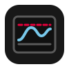

# T2 Zone Power

<p align="center">

</p>

Applies the power limits of the SMC on T2 Macs running Linux, the way macOS does.

The SMC balances the shared heatpipe between CPU and GPUs itself. It hands
out limit steps for the CPU, the integrated GPU, the discrete GPU and forced
idle. macOS only applies them. Linux ignored them so far, so the SMC kept
escalating until it throttled the CPU through PROCHOT.

## How it works

`t2-zonepowerd` reads the steps from the t2smc driver (`smc_plimit_raw`) and
applies them every 250 ms.

| Step | Linux | macOS counterpart |
|---|---|---|
| CPU | `scaling_max_freq` = highest turbo - 100 MHz per step, down to the lowest clock | X86PlatformShim to XCPM |
| Forced idle | `intel_powerclamp`, idle share of `100 - step` percent, at most 70 % | X86PlatformShim to XCPM |
| dGPU | `power1_cap` from the PowerTune table, TDP down to the driver floor in 16 steps | AGPM to the AMD driver |
| iGPU | i915 `gt_max_freq_mhz` = RP0 - 50 MHz per step, down to RPn | AGPM to the Intel framebuffer |

The dGPU floor follows the macOS drivers. Navi 1x goes down to 40 % of its
TDP, Polaris down to 0 W. A runtime suspended dGPU is left alone and gets its
cap once it wakes. On exit the daemon restores all limits.

Like AGPM on macOS, the daemon tells the SMC how many steps each GPU has
(`HE0N` for the dGPU, `HI0N` for the iGPU, through t2smc). The dGPU gets 16
steps once a supported dGPU is found, the iGPU gets the RP0 to RPn range of
i915. Without the dGPU count the SMC does not limit the dGPU and balances the
heatpipe on the CPU alone.

Like X86PlatformPlugin, the daemon also reports the CPU P-state range
(`MSTS` and `MSPC` through `smc_cpu_floor`): the turbo P-states and the
non-turbo P-states above the CPUFloor of the board plist.

The daemon only acts on the data version 3 layout of the SMC power limits
(`smc_plimit_version`). Other versions are not known yet.

The GUI shows zone power against target, zone throttle, the applied limits
and CPU, dGPU and fin stack temperatures. It has no settings.

The daemon logs only errors. Started with `--daemon --debug` it also logs
every change of the power limit steps to the journal.

## Requirements

- t2smc with `smc_plimit_raw`, `smc_plimit_version` and the GPU step count files
- `intel_pstate` or another cpufreq driver
- `intel_powerclamp`

## Build and install

```
make build
sudo make install
```

`make install` installs the binary, the desktop file, the icon and
`t2-zonepowerd.service`, and enables the service.
